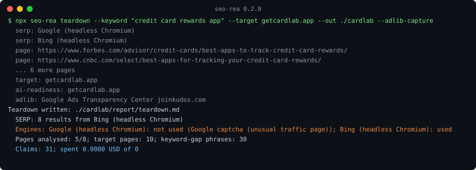

# seo-rea

**Reverse engineer why pages rank, and check if a site is ready for AI search. Evidence first, free sources first.**

[](https://www.npmjs.com/package/seo-rea)
[](LICENSE)
[](docs/mcp.md)
[](.nvmrc)

`seo-rea` is a CLI, an MCP server and an agent skill. Give it a keyword and
your domain. It finds who ranks, reads their pages, validates their structured
data, checks whether AI crawlers and `llms.txt` let AI search engines read your
site, computes the keyword gap, looks up competitor ads, and writes a report
where every claim points to a saved piece of evidence (`E001`, `E002`, ...).

Paid data is optional and capped. At the default budget of 0 USD no paid call
is ever made.



## Sample output

An excerpt of a real run against getcardlab.app
([full report](examples/cardlab-teardown/report/teardown.md), [evidence index](examples/cardlab-teardown/evidence/index.md)):

```markdown
## 1. Summary: why the winners win

- _(inferred)_ Search intent is comparison/roundup: 5/8 titles use "best", "top", a year or
  review wording. Results for this query reward roundup and comparison content, not product
  homepages. [E001, E003, E007, E010, E011, E012, E013]
- getcardlab.app does not appear in the observed results (top 8 organic results from
  Bing (headless Chromium) (en-US, logged out) on 2026-10-15). [E001, E003]
- AI readiness: no AI crawler blocked; llms.txt valid. [E021, E019, E020]

## 2. SERP map (what each engine did)

| Path            | Engine                     | Status                                          | Organic | Evidence |
| --------------- | -------------------------- | ----------------------------------------------- | ------- | -------- |
| serp-playwright | Google (headless Chromium) | not used: Google captcha (unusual traffic page) | 0       | E001     |
| serp-playwright | Bing (headless Chromium)   | used (HTTP 200, relevance 90%)                  | 10      | E003     |

## 4. Schema validation

| Page     | Type                | Result     | Errors                                |
| -------- | ------------------- | ---------- | ------------------------------------- |
| target / | SoftwareApplication | **errors** | needs one of: aggregateRating, review |

## 8. Ads

| Advertiser     | Platform                       | Status   | Visible count |
| -------------- | ------------------------------ | -------- | ------------- |
| joinkudos.com  | Google Ads Transparency Center | captured | 46            |
| maxrewards.com | Meta Ad Library                | captured | 61            |
```

## Quickstart

```sh
npx seo-rea cardpointers.com                          # strategy dossier: why this site leads
npx seo-rea getcardlab.app --vs cardpointers.com      # side by side, plan for the challenger
npx seo-rea teardown --keyword "credit card rewards app" --target getcardlab.app --out ./cardlab
npx seo-rea audit getcardlab.app          # single-site AEO checks
npx seo-rea crawl getcardlab.app          # whole-site crawl, resumable, up to 5000 pages
npx seo-rea diff runs/last-week runs/this-week   # fixed / new / regressed since last run
npx seo-rea reverse cardpointers.com      # reverse engineer a domain's SEO/AEO strategy, $0
npx seo-rea doctor                        # which optional adapters can run here
```

Node 22 or later. The headless-browser SERP path and ad-library screenshots
need the optional `playwright-core` package next to seo-rea, plus a Chromium
download (once, into your user cache):

```sh
npx playwright install chromium
npx -p seo-rea -p playwright-core seo-rea teardown --keyword "..." --target example.com --out ./run
# or in a project: npm i seo-rea playwright-core
```

Without it, seo-rea falls back to plain HTML SERPs, then to URLs you paste
(`--serp-urls`) or a results page you saved from your browser (`--serp-html`).

## Strategy dossier

`seo-rea <domain>` (same as `seo-rea strategy <domain>`, MCP tool
`seo_strategy`) explains why a site leads, from free sources:

- Maps up to 200 URLs from sitemaps and navigation (robots.txt respected,
  3 s between requests to one host) and fetches about 30 pages.
- Groups them into clusters by path and title words, with page counts,
  template type, hub pages and link density, and flags programmatic
  templates (one slug pattern or one heading set across many URLs).
- Derives about 10 head terms from the site's own titles, H1s and slugs and
  checks them on free SERPs. Blocked engines are recorded and not asked again;
  blocked terms are listed as unknown.
- Lists co-ranking domains, scores six pillars (on-page, technical, off-page,
  AEO, paid, distribution), and ranks 5-8 drivers by strength with how hard
  each is to copy.
- Writes a copyable playbook, weaknesses and openings, a 30/60/90-day plan and
  a "Top 10 actions" table. With `--vs`, it adds a side-by-side table, cluster
  gaps, keyword overlap and gaps, and writes the plan for whichever site the
  evidence shows is behind.

Off-page signals at $0: Tranco rank, Wikipedia links and mentions, Common
Crawl index size, App Store ratings (iTunes Lookup) and brand-SERP coverage.
Backlink counts and search volume need paid data and are listed as unknowns.

```sh
seo-rea nerdwallet.com --out ./nw --json > nw.json   # strategy.json on stdout
```

Files: `report/strategy.md`, `report/strategy.json` (`kind: "strategy"`,
`schemaVersion: "1"`, schema in
[docs/strategy-schema.json](docs/strategy-schema.json)), `evidence/` and
`data/strategy-run.json`. Examples:
[cardpointers.com](examples/strategy-cardpointers/report/strategy.md),
[nerdwallet.com](examples/strategy-nerdwallet/report/strategy.md),
[getcardlab.app vs cardpointers.com](examples/strategy-cardlab-vs-cardpointers/report/strategy.md).

## Output for agents

Every `teardown` and `audit` also writes `report/dossier.json`: a versioned
JSON summary (`schemaVersion: "1"`) with inputs, cost, SERP engine statuses,
competitors, target pages, schema validation, AI readiness, performance,
keyword gap, ads, citations, claims with evidence IDs, unknowns and up to 10
ranked `topActions`. It is validated against
[docs/dossier-schema.json](docs/dossier-schema.json) before it is written.
The same actions appear as a "Top 10 actions" table at the top of
`teardown.md` and `audit.md`.

```sh
seo-rea audit getcardlab.app --json > cardlab.json      # dossier on stdout, progress on stderr
seo-rea batch --sites sites.json --out out/2026-10-14   # many sites, plus summary.json and summary.md
```

`batch` reads a JSON list (`[{"name", "site", "keyword"}]`) or a CSV with a
`site` column and optional `keyword` and `name` columns. It runs `audit` for
every site and `teardown` for sites with a keyword, one site at a time, and
skips entries whose domain is `TODO`. See
[examples/desk-sites.example.json](examples/desk-sites.example.json).

## Run on a box / server

```sh
git clone https://github.com/DevgenX/seo-rea /workspace/seo-rea && cd /workspace/seo-rea && npm ci && npm run build && node dist/cli.js doctor
```

Optional, for the headless-browser SERP path and ad-library screenshots:

```sh
npx playwright install chromium
```

Without Chromium, `teardown` and `batch` fall back to plain HTML SERPs; if
those are blocked too, pass the ranking URLs with `--serp-urls`. Then run, for
example:

```sh
node dist/cli.js batch --sites examples/desk-sites.example.json --out out/$(date +%F) --budget-usd 0
```

## Use it from your agent (MCP)

**Claude Code**

```sh
claude mcp add seo-rea -- npx -y seo-rea mcp
```

**Cursor** (`.cursor/mcp.json`)

```json
{
  "mcpServers": {
    "seo-rea": { "command": "npx", "args": ["-y", "seo-rea", "mcp"] }
  }
}
```

**Codex** (`~/.codex/config.toml`)

```toml
[mcp_servers.seo-rea]
command = "npx"
args = ["-y", "seo-rea", "mcp"]
```

**Grok Bot**: add a custom MCP server in its settings (connectors) with
transport stdio, command `npx` and arguments `-y seo-rea mcp`. Menu names vary
between versions.

More clients, environment variables and troubleshooting:
[docs/client-configuration.md](docs/client-configuration.md). Tool reference:
[docs/mcp.md](docs/mcp.md).

### Install the skill

The skill tells an agent how to run a teardown and read the evidence. Copy it
into your agent's skills folder:

```sh
git clone https://github.com/DevgenX/seo-rea
cp -r seo-rea/.agents/skills/seo-rea ~/.claude/skills/        # Claude Code
cp -r seo-rea/.agents/skills/seo-rea ./.agents/skills/         # project-level agents
```

The npm package ships the same folder under `.agents/skills/seo-rea`.

## Features

| Area                | What you get                                                                                                                               | Source                                                     |
| ------------------- | ------------------------------------------------------------------------------------------------------------------------------------------ | ---------------------------------------------------------- |
| SERP                | Ranking list with what every engine did (used, captcha, consent wall, degraded)                                                            | Headless Chromium -> plain HTML -> your URLs or saved page |
| Competitor cards    | Title, meta, H1-H3, word count, canonical, internal links, top anchors                                                                     | Raw HTML, robots.txt respected                             |
| Schema validation   | Required and recommended properties for Article, FAQPage, Product, SoftwareApplication, Organization, BreadcrumbList, HowTo, LocalBusiness | JSON-LD                                                    |
| AI-search readiness | Access for GPTBot, OAI-SearchBot, ChatGPT-User, ClaudeBot, Claude-SearchBot, PerplexityBot, Google-Extended, Applebot-Extended, CCBot      | robots.txt                                                 |
| llms.txt            | `/llms.txt` and `/llms-full.txt` checked against llmstxt.org                                                                               | Site files                                                 |
| Page speed          | Performance, SEO, accessibility scores; LCP, CLS, TBT; CrUX field data                                                                     | PageSpeed Insights, optional local Lighthouse              |
| Keyword gap         | Phrases two or more ranking pages use that your site does not                                                                              | n-grams + TF-IDF                                           |
| Ads                 | Google Ads Transparency, Meta and LinkedIn ad-library lookups, optional screenshot and visible count                                       | Ad libraries                                               |
| AI citations        | Table of which domains AI answers cite for your prompts                                                                                    | Logged with `cite`                                         |
| Finding ledger      | Every claim with evidence IDs, observed vs inferred, confidence, search boundary, unknowns                                                 | All of the above                                           |

## Free vs paid data

| Data                       | Free (default)                         | Paid (optional)                              | Cost                      |
| -------------------------- | -------------------------------------- | -------------------------------------------- | ------------------------- |
| SERP                       | Headless browser, HTML, your URLs      | DataForSEO SERP, only if no free SERP worked | about 0.002 USD per query |
| Ranked keywords and volume | Not available                          | DataForSEO Labs ranked keywords              | about 0.02 USD per domain |
| Page speed                 | PageSpeed Insights (free key optional) | -                                            | 0                         |
| Everything else            | Built in                               | -                                            | 0                         |

Paid calls need `DATAFORSEO_LOGIN` and `DATAFORSEO_PASSWORD` in the
environment and `--budget-usd` above 0. Each call is checked against the run
budget and optional monthly cap before it is made, cached, and logged to
`.seo-rea/ledger.csv`.

## How it works

1. **SERP.** Your URL list or saved page if given; then headless Chromium per
   engine (at least 3 s between requests to one host, real desktop user agent,
   cookie banners rejected, captchas detected and recorded); then plain HTML.
2. **Ranking pages.** Each is fetched once (robots.txt respected) and parsed:
   on-page facts and JSON-LD validation.
3. **Your site.** robots.txt, sitemaps, homepage and up to `--crawl` pages; AI
   crawler access; llms.txt; PageSpeed Insights.
4. **Keyword gap.** Phrases used by two or more ranking pages and absent from
   every crawled page of yours.
5. **Ads.** Lookup URLs for your brand and up to three competitors (product
   sites first), with screenshots when `--adlib-capture` is set.
6. **Report.** `evidence/` (E001.. + index), `report/teardown.md`,
   `report/dossier.json`, `report/ledger.md`, `report/questions.md`,
   `data/run.json`.

More: [docs/cli.md](docs/cli.md), [docs/sources.md](docs/sources.md).

## Prior art and credits

- [morluto/rea](https://github.com/morluto/rea) (MIT): the evidence-first
  workflow, project structure, CLI + MCP + skill layout and engineering bar
  this project follows. No code was copied.
- [Rachit8484/geoseo-mcp](https://github.com/Rachit8484/geoseo-mcp) (MIT):
  ideas for LLM-citation logging and llms.txt tools.
- [maxaeo/maxaeo-ai-visibility-mcp](https://github.com/maxaeo/maxaeo-ai-visibility-mcp)
  and [maxaeo/llms-txt-validator](https://github.com/maxaeo/llms-txt-validator)
  (MIT): the AI-crawler and llms.txt check list.
- [AgriciDaniel/claude-seo](https://github.com/AgriciDaniel/claude-seo) (MIT):
  how to split SEO work into skill steps.
- [GoogleChrome/lighthouse](https://github.com/GoogleChrome/lighthouse)
  (Apache-2.0, optional), [cheerio](https://github.com/cheeriojs/cheerio) (MIT),
  [playwright](https://github.com/microsoft/playwright) (Apache-2.0, optional).

All seo-rea code is original. See [THIRD_PARTY_NOTICES.md](THIRD_PARTY_NOTICES.md).

## FAQ

**Does it scrape Google?** It tries once per run in a headless browser, at a
polite pace, and records the result. Google usually shows a captcha to
automated browsers; seo-rea notes that and moves on to Bing or DuckDuckGo. For
Google rankings, search in your own browser and pass `--serp-urls` or
`--serp-html`.

**Will it spend money?** Not by default. The budget is 0 USD, and every paid
call is refused at 0 before any request is made.

**Why do some competitor pages say "Not analysed"?** Some sites return HTTP 403
to non-browser clients or disallow crawling in robots.txt. The report records
the reason.

**Is "no AI crawler blocked" the whole story?** No. It reads robots.txt only.
A CDN or firewall can still block bots; that is listed as an unknown.

**Does it publish anything?** No. It writes local files. It never sends
outreach, buys ads or changes a site.

## Contributing

See [CONTRIBUTING.md](CONTRIBUTING.md) and [AGENTS.md](AGENTS.md). Security
reports: [SECURITY.md](SECURITY.md).

## License

MIT. Copyright (c) 2026 DevgenX. See [LICENSE](LICENSE).
